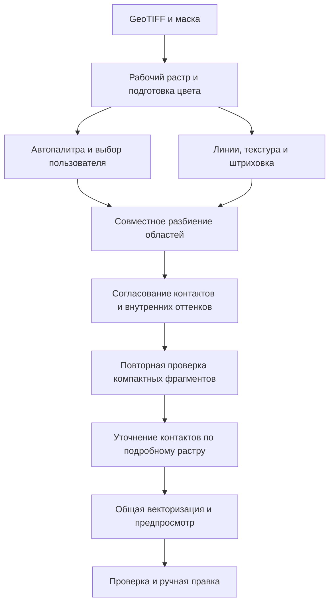

# Алгоритм и устройство GeoTrace 1.1

## Задача и границы применения

Вход — уже геопривязанный цветной скан карты. Выход — общий полигональный слой с редактируемыми атрибутами. Программа не выполняет геопривязку, OCR легенды и автоматическое присвоение геологических возрастов. Цветовой класс и геологическое подразделение — разные понятия: несколько полигонов могут принадлежать одному цвету, а близкие заливки — разным подразделениям.

Цель основного метода — учитывать несколько независимых признаков и сохранять общую топологию. Параметры не выбираются по имени карты, координатам эталона или ID полигонов. Эталонные векторы используются только для оценки после расчёта.

## Основной путь «Цвет + границы»

1. **Чтение.** Палитра раскрывается до уменьшения изображения, чтобы смешивание индексов не меняло цвета. RGB 0–255 в uint16 проверяется по блокам; высокие радиометрические значения отклоняются. NoData, альфа и внутренние маски исключаются из покрытия.
2. **Восстановление заливки.** Цвет переводится в Lab. Учитываются зернистость печати, локальная открытая бумага и согласие цвета с разных сторон штриха; противоречивые пробы не получают уверенного восстановления. Исходные штрихи сохраняются отдельным источником информации.
3. **Палитра.** Детерминированный поиск устойчивых заливок; при заполнении первоначального набора проверяется расширение до 24 цветов. Редкая заливка не удаляется только из-за малого размера. Ручные образцы и исключение/объединение групп меняют разрешённые классы, а не геологический смысл.
4. **Границы.** Изменение цвета, тёмные штрихи, их непрерывность и плотность печати образуют поле вероятных контактов. Совместное разбиение создаёт единое владение пикселями вместо независимого построения каждого полигона.
5. **Штриховка и согласование.** Повторяющиеся направления и шаг штрихов помогают соединять заливку под рисунком. Согласование соседей проверяет бумагу, цвет, штрихи и текстуру. Подтверждённый контакт нельзя обойти транзитивным объединением через третью область.
6. **Внутренние оттенки.** Близкие заливки внутри класса разделяются только при достаточной площади связных частей и протяжённом подтверждённом контакте. Изменение одной яркости или одиночная отметка недостаточны.
7. **Мелкие фрагменты.** Повторная проверка после согласования может присоединить компактную неоднозначную помеху к доминирующему соседу. Узкие линзы, уверенные редкие цвета, подтверждённые границы и края маски защищены. При ручных группах очистка ограничена выбранными классами.
8. **Подробный исходник.** В узкой полосе возле контактов сравниваются линия, геометрия, исходное положение и цвет открытой бумаги соседей. Модели цвета берутся из надёжных внутренних участков, без контура и тёмной печати. В 0.8 beta ограниченный голос цвета усилен с 0,20 до 0,35, чтобы разрешать слабые противоречия на ступенчатых контактах. Он остаётся слабее сильного линейного свидетельства (0,85); для чернил, неподдержанных малых областей и посторонних цветов дополнительного голоса нет. Само изменение веса не гарантирует улучшения каждого контакта.
9. **Топология.** Перемещаются только простые пиксели контакта с двумя непрерывными дугами соседей и опорой по сторонам. Это ограничивает появление островов, разрыв перемычек, заполнение отверстий и движение многолучевых узлов. Векторизация и упрощение работают с общим покрытием; независимое сглаживание каждого полигона не применяется.
10. **Применение.** Пользователь принимает предпросмотр. При повторной обработке защищённые ручные объекты сохраняются; новый результат подрезается с учётом их геометрии. Проверка сомнений помогает найти рискованные участки, но не является полной автоматической проверкой геологии.

## Производительность и воспроизводимость

Рабочая длинная сторона — до 1600 пикселей, подробный анализ — до 12 млн пикселей. Контактные кандидаты обрабатываются пакетами до 65 536. Для палитрового декодирования используются блоки 512×512, ограничение GDAL-кэша 32 МБ и временный дисковый кэш: до двух декодированных файлов и 256 МБ суммарно. Превышающий бюджет временный файл не остаётся в кэше. Ключ учитывает исходник и служебные маски; изменение маски требует перечитывания.

Основной расчёт выполняется в отдельном процессе на CPU и проверяет отмену между этапами/пакетами. Прогресс не является условием успешного расчёта: кратковременная блокировка файла прогресса в Windows повторяется ограниченное число раз и не должна уничтожать результат. Оценка времени приблизительна. Указанные ограничения не являются общим пределом ОЗУ процесса: промежуточные массивы и геометрия требуют дополнительной памяти.

Устойчивое раскрытие палитры выполняется без вложенных VRT: прежний путь давал нестабильные результаты между платформами. Повторяемость проверяется на одинаковых декодированных пикселях и масках; разные версии библиотек или входных данных необходимо фиксировать при сравнении.

## Карта кода

| Модуль | Ответственность |
| --- | --- |
| `core.py`, `raster_colors.py` | Чтение, нормализация цвета, базовая векторизация и экспорт |
| `quality.py` | Подготовка, основной конвейер, подробное уточнение, прогресс/отмена |
| `contacts.py`, `hatching.py` | Согласование соседей и печатной текстуры |
| `palette.py` | Пробы пользователя и разделение цветовых групп |
| `automatic.py` | Сохранение ручной работы при повторной обработке |
| `boundary_drag.py`, `editing.py` | Общие границы, лассо и операции геометрии |
| `attributes.py`, `table.py` | Схема, фильтры и массовое заполнение |
| `project.py`, `region.py` | Проекты, восстановление и KML-обрезка |
| `basemap.py`, `webmap.py` | Подложки основного редактора и JavaScript-вкладка |
| `app.py`, `qml/` | Состояние приложения и интерфейс Qt Quick |
| `release_info.py`, `tools/write_build_info.py` | Идентификатор версии и сборки |

Внешние сервисы нужны для сетевых подложек, а основной путь оцифровки обрабатывает локальные данные. Дополнительный MobileSAM — отдельный исследовательский метод и не является основой этого конвейера.

## Проект участка и завершающая обработка версии 1.1

`document.py` объединяет несколько геопривязанных листов и KML в окне EPSG:3857. Группы сопоставляются отдельно от геометрии. Физические измерения выполняются геодезически на WGS84. Авторитетным результатом при открытии остаётся сохранённый слой, повторная оцифровка запускается явно.

`smoothing.py` обрабатывает общую сеть границ, фиксируя узлы и внешний контур покрытия. Режимы включают осторожное срезание ступенек, более плавную обработку и упрощение. Смещение ограничено разрешением исходника; проверяются корректность, покрытие, перекрытия, отверстия, площадь и расстояние до прежнего контура. При численных затруднениях общая задача разбивается на безопасные пары соседей, проблемные контакты сохраняются. Автоматический шаг выполняется перед возвращением защищённых ручных объектов. Ручной инструмент пересчитывает пробы от исходного состояния и применяет результат через обычный механизм отмены.

`detail_tiles.py` читает 512-пиксельные фрагменты с запасом вокруг экрана и уровнями разрешения. Сохраняются ограниченный кеш и прежняя детализация, приоритет получает текущий масштаб. `sheet_seams.py` отвечает за ограниченную интерполяцию светлого края скана только при отображении и скрытие технической обводки сопоставленных классов, не объединяя геометрию. `topology.py` очищает численные вырождения и реализует вырезание новой области; `groups.py` согласует классы и ссылки листов.

`updates.py` получает стабильный выпуск по HTTPS, выбирает архитектуру, проверяет размер и SHA-256 пакета и повторно проверяет файл перед запуском. Доступ к ключам или токенам GitHub для публичного канала не нужен. Нативные сборки проверяются до и после установки на каждой целевой системе.

## Соединение границ

`boundary_connect.py` работает с локальным участком покрытия. Привязка выбирает соседний контур по расстоянию, направлению и сопоставимой длине; выбранный сосед удерживается при небольших колебаниях указателя. При переносе внутрь соседнего объекта перемещённая линия становится общей, перекрытая часть соседней области вычитается. Общие вершины записываются одинаковыми координатами с обеих сторон, включая точки присоединения внутри сегмента.

Выбор двумя кликами задаёт дугу исходного кольца. Можно сохранить исходный контур или контур найденного соседа. Соединение проверяет корректность, перекрытия, доступный охват, внутренние области и скрытые группы; удаление или разделение объектов требует отдельной операции и не выполняется скрытно. Предпросмотр рассчитывается в отдельном потоке, окончательное построение и растеризация — в рабочем процессе. Смена результата и отмена инвалидируют ожидающие кадры.
