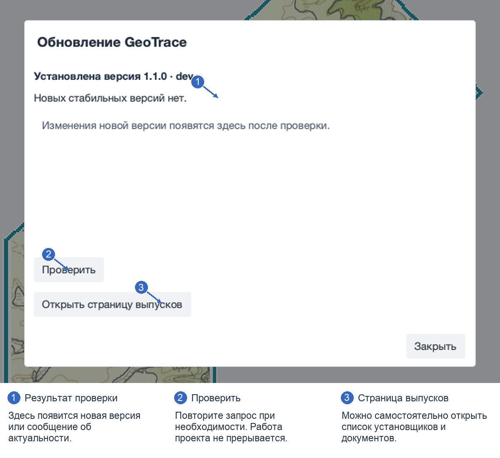
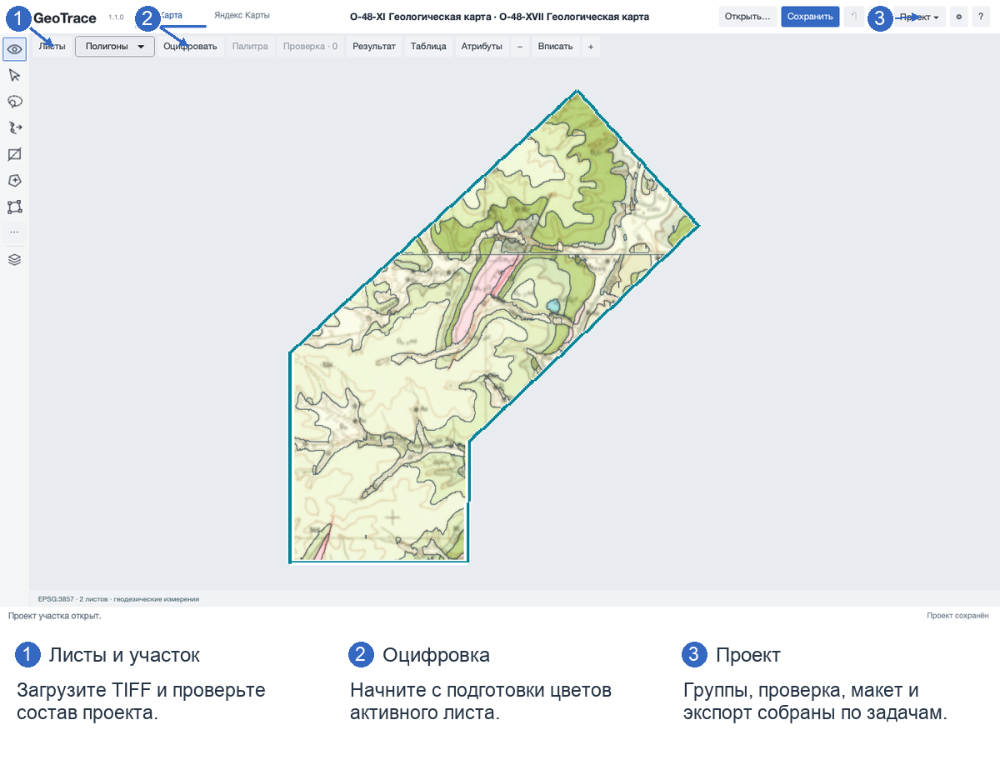
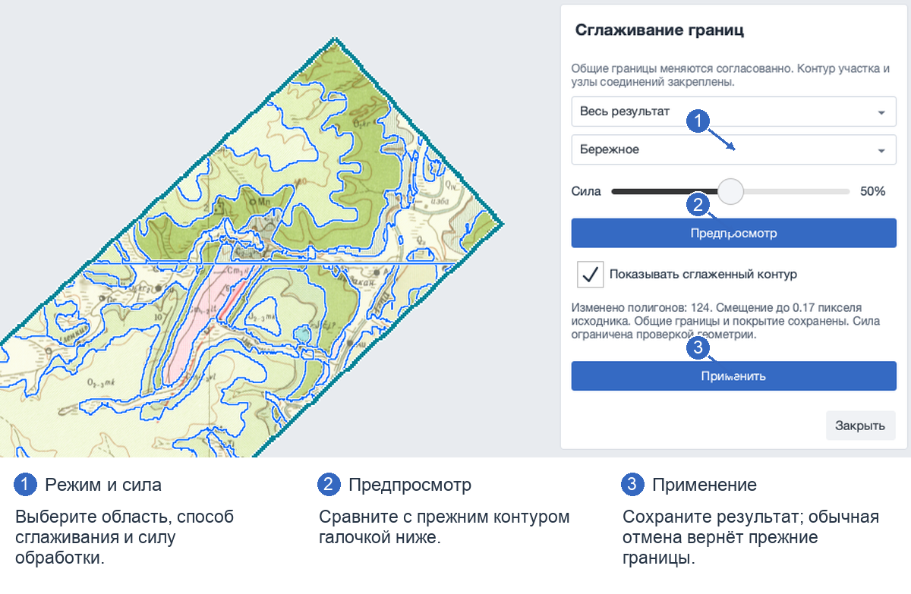
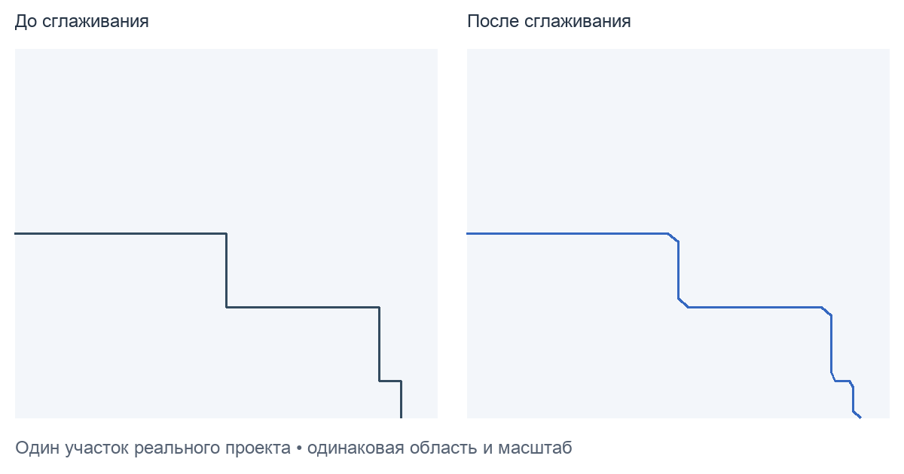
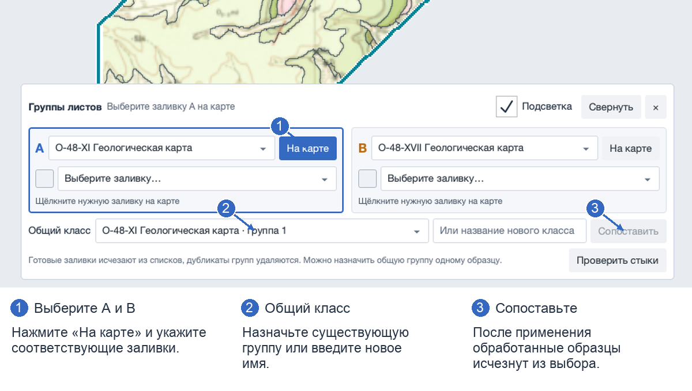
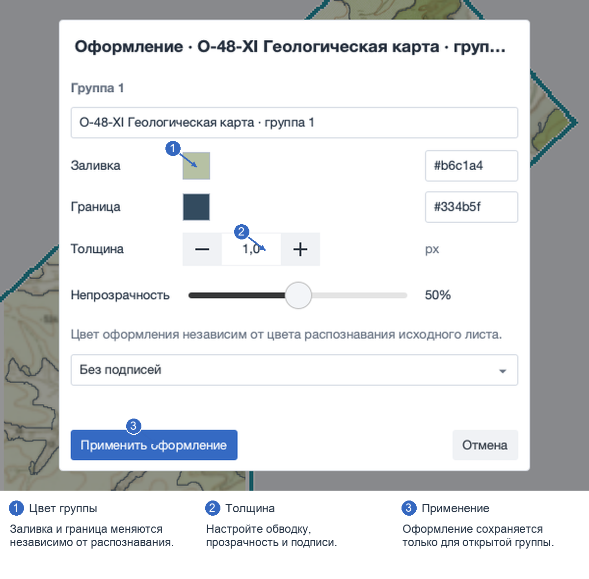
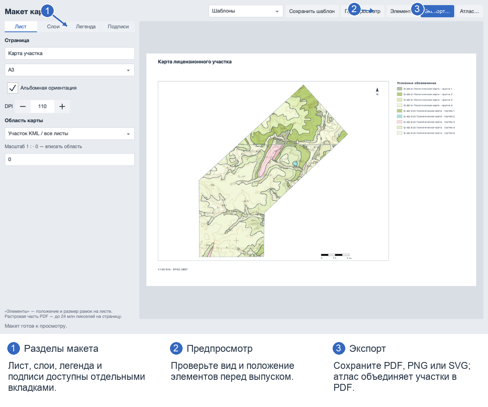

# Руководство пользователя GeoTrace

Версия 1.1.0. Рабочий процесс для геопривязанных геологических карт.

GeoTrace создаёт редактируемые полигоны и линейные объекты по сканам карт. Основной сценарий — подготовить листы, получить автоматический результат, проверить спорные места, заполнить атрибуты и выпустить карту участка. Геологическое значение цветовых групп задаёт специалист. Программа не определяет возраст и название подразделений по одному цвету.

## Установка и обновление

Установщики и контрольные суммы публикуются в GitHub Releases. Выбирайте файлы одной версии и номера сборки; отдельно устанавливать Python не нужно.

В GitHub Releases выберите установщик своей системы и архитектуры. Для Windows x64 предназначен файл `GeoTrace-1.1.0-buildN-Windows-x64-Setup.exe`. Мастер запрашивает права администратора и по умолчанию устанавливает программу в `C:\Program Files\GeoTrace`, создавая ярлыки в меню «Пуск». Само приложение работает с обычными правами. При обновлении прежняя пользовательская установка переносится; проекты и настройки сохраняются. Для Mac используйте `.pkg` своей архитектуры: arm64 — Apple Silicon, x86_64 — Intel. Мастер устанавливает GeoTrace в «Программы». Рядом доступен ZIP с самим приложением.

Готовая сборка содержит Python и необходимые библиотеки: отдельно устанавливать их не нужно. Основной алгоритм работает на процессоре; мощная видеокарта не обязательна. Для небольших листов ориентируйтесь на 8 ГБ ОЗУ, для нескольких подробных листов предпочтительнее 16 ГБ и более. Это рабочий ориентир, а не результат испытания всех конфигураций. Сборка Mac с Qt 6.12 требует macOS 14.4 или новее; Windows — 64-разрядная Windows 10/11.

Установщики выпускаются без платных сертификатов издателя. Система может показывать предупреждение о неизвестном разработчике; сертификат и нотариализация не заменяются оформлением мастера. Сверяйте источник загрузки и SHA-256 из выпуска. Проекты храните в отдельной пользовательской папке. Перед обновлением сохраните текущий `.geotrace` и при необходимости сделайте его копию. Версия видна рядом с названием программы; полный build и сведения — в справке.

Проверка обновлений доступна через **F1 → Обновления** и **О программе → Проверить обновления**. Программа показывает доступную стабильную версию, описание изменений и подходящий пакет. **Скачать** сохраняет установщик в кеше и проверяет размер и SHA-256. Затем нажмите **Установить**: при несохранённых изменениях сначала появится предложение сохранить проект. GeoTrace закрывается после успешного запуска установщика. Скачивание можно отменить; при недоступности сети продолжайте работу и повторите проверку позже.

## Что подготовить

Нужны геопривязанные TIFF с записанной системой координат. Поддерживаются RGB/RGBA 8 бит, палитровые TIFF и RGB со значениями 0–255 в контейнере uint16. Настоящие 16-битные радиометрические снимки не предназначены для этого цветового алгоритма. JPEG без координат сначала привяжите в ГИС: ручной геопривязки в GeoTrace нет.

Контур лицензионного участка передайте как KML с полигонами; внутренние вырезы сохраняются. Можно начать с KML и затем добавить карты либо сначала загрузить листы. Держите исходные TIFF доступными до завершения работы: по ним программа получает подробное изображение и выполняет повторный анализ.

## Создание проекта участка

1. На начальном экране нажмите **Добавить KML**, выберите контур и подтвердите **Выбрать участок**. Если контуров несколько, можно выбрать один либо общий контур.
2. Нажмите **Добавить листы** и выделите один или несколько TIFF. Их координаты автоматически согласуются в окне EPSG:3857.
3. Откройте **Листы**. Проверьте названия, видимость и активный лист. Активный лист используется для подготовки цветов и поиска линий.
4. Сохраните проект через **Сохранить**. Дальше сохраняйте изменения по Ctrl/Cmd+S.

Исходные файлы не переписываются. KML обрезает общий рабочий результат, но полные листы сохраняются для подготовки и распознавания. При повторном открытии проекта не требуется заново добавлять карты. На запуске эмблема показывается минимум 1,1 секунды; в это время уже загружается приложение. Рабочее окно использует прямоугольные координаты EPSG:3857; физические площади и длины вычисляются отдельно на эллипсоиде WGS84.

В режиме **Просмотр** карту можно двигать левой кнопкой по свободному месту или двумя пальцами на тачпаде. Жест сведения и разведения пальцев плавно меняет масштаб под указателем. Для мыши используйте колесо; Ctrl с прокруткой тачпада тоже меняет масштаб. **Вписать** возвращает вид участка KML, а без него — всех листов. Доступно отдаление значительно дальше исходного охвата.

Подробное изображение читается фрагментами с кешированием и запасом вокруг экрана. Уже загруженные фрагменты остаются при движении; для нового участка и нового масштаба детали догружаются в фоне. Без доступного исходного TIFF подробность ограничена изображением, встроенным в проект.

## Навигация по меню проекта

Меню **Проект** разделено на **Листы и участок**, **Объекты**, **Проверка** и **Экспорт**. В первом разделе находятся карты и KML; во втором — группы, сопоставление, поля и сглаживание; в третьем — стыки и сводка; в четвёртом — макет и пространственные данные. Сохранение с исходниками и контрольные сохранения расположены отдельным блоком. Настройки карт открываются шестерёнкой рядом с меню; справка и обновления — через **?** или F1.

## Подготовка полного листа

Выберите лист и нажмите **Подготовить активный лист** либо **Оцифровать**. Дождитесь окна подготовки. Палитра показывает устойчивые цветовые заливки всего листа, включая части за пределами KML. Обработка подробного TIFF ограничена 12 млн пикселей на лист для контроля памяти; фактическое разрешение сообщается в окне подготовки.

Нажмите образец цвета, чтобы подсветить его области. Повторное нажатие либо выключение **Подсветка цвета** убирает подсветку. Галочка рядом с цветом отдельно определяет его участие в оцифровке. Ненужную заливку можно исключить. Для двух оттенков одного подразделения выберите назначение и нажмите **Объединить**.

Если алгоритм смешал две нужные заливки, включите **Новая группа · пипетка** и укажите однородное место вдали от текста и границ. Проверьте появившуюся группу по подсветке. Пипетка разделяет оттенки внутри исходной группы; она не присваивает геологическое название. Если разделение не получилось, возьмите другой участок либо верните автоматическую палитру.

Карту в подготовке можно двигать перетаскиванием и увеличивать колесом или кнопками. **Вся карта** возвращает общий вид. Если на полном скане есть легенда, разрезы и поля, включите **Рамка листа без легенды** и обведите только картографическое поле. После изменения рамки повторите подготовку. **Сбросить рамку листа** возвращает исходный охват; KML участка при этом сохраняется.

## Автоматическая оцифровка

Из подготовки запустите расчёт. Полоса выполнения показывает текущий этап и приблизительное оставшееся время. Оценка уточняется по ходу работы и может меняться на сложных стадиях. Для двух и более листов команда **Оцифровать все листы** запускает последовательную обработку, чтобы не умножать расход памяти. Сохранённые настройки палитры учитываются при повторном расчёте.

После распознавания автоматически выполняется бережное сглаживание общих границ. Мелкие ступеньки сглаживаются в пределах доли исходного пикселя; узлы, внешний контур и реальные внутренние области защищены. Если безопасное изменение невозможно, соответствующая граница сохраняется. После расчёта появляется общий предпросмотр. Сравните его с исходником, затем примените результат либо закройте предпросмотр. Неприменённые предложения не входят в сохранённый проект и экспорт. **Остановить** прерывает обработку после текущего проверяемого этапа, сохраняя прежние применённые данные. Применение результата можно отменить.

Принятые, отредактированные вручную объекты и заполненные пользовательские атрибуты защищаются при повторной оцифровке. Проверяйте результат после изменения участка: объекты за его пределами исключаются из общего слоя. Для экспериментов удобно предварительно создать контрольное сохранение.

## Сглаживание границ

Откройте **Проект → Объекты → Сглаживание границ**. Панель остаётся справа, карта доступна для просмотра. Выберите весь результат, группу либо выделенные полигоны; затем режим **Бережное**, **Плавное** или **Упрощение** и силу обработки. Бережное убирает мелкие ступеньки, плавное сильнее смягчает изгибы, упрощение уменьшает число вершин.

Нажмите **Предпросмотр**. Галочка **Показывать сглаженный контур** переключает результат и прежние границы. Изменение параметров требует нового предпросмотра; пробы рассчитываются от исходного состояния, а не поверх предыдущей пробы. **Применить** сохраняет изменение, обычная отмена возвращает прежнюю геометрию. **Закрыть** без применения сохраняет исходный результат.

Общие границы обрабатываются согласованно для обоих соседей. Сила ограничена размером пикселя исходной карты; программа проверяет корректность, перекрытия, отверстия и изменение площадей. Проблемные контакты могут остаться без изменений. Сглаживание улучшает форму линии, но само по себе не подтверждает её геологическую точность.

## Сопоставление листов и проверка стыков

Один и тот же объект на соседних листах может иметь разный цвет. Откройте **Проект → Объекты → Сопоставить группы листов**. Внизу карты появится компактная панель; карта остаётся доступна для перемещения и приближения.

1. В карточке **A** выберите первый лист и нажмите **На карте**. Щёлкните нужную заливку непосредственно на карте. Она подсветится синим.
2. В карточке **B** выберите соседний лист и щёлкните соответствующую заливку. Подсветка второй группы — янтарная. Вместо клика можно выбрать группу в списке карточки.
3. Выберите общий класс проекта либо введите новое название и нажмите **Сопоставить**. Группы перейдут в один класс; лишние классы проекта удалятся. Обработанные образцы исчезнут из списков карточек, а выбор очистится.
4. Для следующего листа можно выбрать один новый образец и назначить ему уже созданный общий класс. Повторно выбирать скрытый обработанный образец не нужно. **Подсветка** убирает цветные обозначения, **Свернуть** освобождает место.

Цвет распознавания листа и оформление общего класса независимы. Подпишите классы по легенде: одинаковый цвет не доказывает одинаковое геологическое значение. Сопоставление меняет принадлежность полигонов к группе, сохраняя их геометрию и атрибуты. В перекрытии приоритет у последнего листа списка; стрелки в окне листов меняют порядок. В версии 1.1 автоматическая сшивка временно отключена, её кнопка убрана. Сопоставление само по себе не удаляет границу между листами. Для проверенного локального объединения используйте выбор полигонов и **Объединить**.

Белая полоса на стыке может находиться в крайнем ряду самого скана, даже когда листы географически точно соприкасаются. В окне **Листы** переключатель **Сглаживать узкие стыки сканов** включает обработку только отображаемой мозаики. Она применяется при обнаружении светлой краевой полосы и затрагивает не более двух исходных пикселей с каждой стороны. На настоящие зазоры, перекрытия и внешние края она не распространяется. Полоса интерполируется по ближайшим внутренним пикселям обоих сканов, поэтому на сильном увеличении этот небольшой участок выглядит мягче. Исходники, координаты, площади и полигоны сохраняются. Отключите переключатель для просмотра необработанного стыка; выбор сохраняется в проекте и отменяется обычной командой отмены. Отдельный лист в подготовке показывается без такой обработки.

У сопоставленных полигонов одинаковой группы техническая обводка точно по общему краю разных листов скрывается в основном окне, Яндекс Картах и макете. Контакты разных групп и границы внутри одного листа остаются. Это изменение оформления: объекты не объединяются, GeoPackage сохраняет их геометрию. При выделении полигона виден его полный контур.

Нажмите **Проверить стыки**. Программа выделит различия классов в перекрытии и непокрытые части участка. Это кандидаты на проверку специалистом. Выключение исходников в **Слоях** помогает отличить векторную границу от рамки, белой полосы или печатной линии на TIFF. Пустые зазоры без данных автоматически не дорисовываются.

## Группы полигонов

Откройте **Проект → Объекты → Группы полигонов** либо **Изменить…** в разделе слоёв. Справа появится панель, оставляющая карту доступной. В списке видны номер, название и количество полигонов. Нажмите цветной квадратик группы в **Слоях** либо **Группах полигонов**. Откроется оформление именно этой группы: название, заливка, цвет и толщина границы, прозрачность, подписи. Выбирать слой повторно не нужно. Завершите кнопкой **Применить оформление**.

Для своей группы нажмите **Новая**, задайте название и цвет, затем создайте её. Пустая группа доступна для назначения существующим объектам и для рисования. Чтобы перенести выбранные полигоны, выберите нужную группу в панели **Атрибуты**; изменение применяется сразу и отменяется обычной командой отмены. Такая же команда есть в панели групп. Поле группы перед рисованием определяет принадлежность нового полигона.

Чтобы удалить используемую группу, сначала выберите группу назначения: объекты перенесутся в неё, их геометрия и пользовательские атрибуты сохранятся. Пустая группа удаляется без переноса. После удаления номера оставшихся групп уплотняются; номера самих объектов сохраняются. Ссылки листов и настройки легенд согласуются с новым списком. Действие можно отменить.

Галочка видимости скрывает группу в основном окне, Яндекс Картах и макете. Скрытая группа не выбирается кликом или лассо. GeoPackage содержит все объекты, в том числе скрытые: видимость управляет отображением, а не удалением данных. Эти настройки сохраняются в проекте.

## Проверка сомнительных участков

Нажмите **Проверка** и переходите назад и вперёд кнопками либо клавишами `[` и `]`. Карта приближает выбранное место. Малиновая отметка показывает сомнительный контакт, мелкий фрагмент или другое предложенное уточнение. **Подсветка сомнения** скрывает обозначение; закрытие проверки убирает его с карты.

Короткое нажатие Shift переключает исходник и результат. Подтвердите проверенное место либо перейдите к ручной правке. Журнал можно сохранить как CSV до открытия другого проекта или выхода. Метки проверки и неприменённые расчёты не заменяют сохранённый слой объектов.

## Редактирование полигонов

**Просмотр** позволяет двигать карту без случайного выделения. Для выбора включите инструмент со стрелкой и щёлкайте по объектам. Лассо отмечает полигоны, попавшие в обведённую область. Несколько выбранных соседних полигонов можно объединить контекстной кнопкой; действие отменяется одним шагом.

**Изменить границу** работает перетаскиванием: приблизьте контакт, захватите его левой кнопкой и потяните. Область захвата составляет примерно восемь экранных пикселей. Обычно перемещается ограниченный плавный участок с неподвижными концами; при большем приближении захватываемый участок становится короче. **Только одна точка** включает локальную правку вершины. Общая граница изменяется у обоих соседей. После отпускания допустимое изменение применяется сразу.

Инструменты разделения и рисования создают предварительный результат по нарисованной линии или контуру. Новый полигон можно нарисовать внутри существующего или поперёк нескольких. Занятая им область вырезается из соседей, общие границы согласуются автоматически. Атрибуты оставшихся частей соседей сохраняются; новый объект получает значения по умолчанию. Полностью перекрытый объект заменяется новым, поэтому проверяйте предпросмотр перед применением. Enter завершает текущий этап, Backspace убирает последнюю точку, Escape отменяет незавершённый ввод или выбор. Нельзя проводить границу через недоступную часть карты или создавать некорректную геометрию. Блокировка слоя в **Слоях** защищает его от изменения.

Ползунок **Толщина** на панели правки меняет толщину отображения границ от 0,5 до 4 экранных пикселей. При приближении они больше не разрастаются вместе с растром. Ползунок не меняет геометрию или оформление экспортируемой карты; область захвата остаётся удобной для мыши. Численно вырожденные внутренние щели после объединения очищаются; реальные внутренние области сохраняются.

Пустая группа удаляется без выбора назначения. Исходные образцы отвязываются от удалённого класса и при необходимости могут быть сопоставлены заново.

## Атрибуты и измерения

В базе полигонов есть номер, группа, примечание и сведения о состоянии объекта. При выборе полигона панель **Атрибуты** показывает номер и название его общей группы проекта; номера исходных групп разных листов могут отличаться. Геологические поля не навязываются. Через **Проект → Поля атрибутов** выберите предлагаемый атрибут или создайте свой: текст, целое число, число, дата, «Да/Нет» либо список вариантов. Можно задать значение по умолчанию и обязательность при экспорте. Изменение типа проверяет существующие значения; несовместимое преобразование отклоняется.

В панели атрибутов выберите область действия: выбранные объекты, группа или текущая выборка. Меняются только отредактированные поля. Режим **Только пустые** сохраняет заполненные значения, включая ноль и «Нет». Для точной выборки используйте таблицу, поиск и фильтры. Массовую операцию можно отменить целиком.

Площадь выбранных полигонов показана в панели; сводка содержит площадь и долю каждого класса в участке. У линий отдельно вычисляется длина. Значения пересчитываются после правки. В GeoPackage сохраняются площадь в м² и гектарах, периметр и длина в метрах. Площадь EPSG:3857 в квадратных координатах не используется как физическая площадь: она заметно искажена на высоких широтах.

## Линии и разломы

Переключите инструменты с **Полигонов** на **Линии**. Основной способ работы с разломами — ручное рисование. **Типы и цвет** открывает небольшую панель справа; она не закрывает всю карту. Создайте тип кнопкой «+», задайте название, цвет, толщину в пикселях, штрих и подпись. Цвет выбирается диалогом, вводится как `#RRGGBB` или берётся **Пипеткой** прямо с исходника на карте. Escape отменяет пипетку.

На вкладке **Рисование** сохраните тип и нажмите **Рисовать линию**. Щелчки задают точки, Enter завершает объект, Backspace убирает последнюю точку. Доступны перенос плавного участка, перенос вершины и разделение. **Продолжить** начинает ввод с конца выбранной линии. В меню **Действия** находятся **Другой конец**, добавление и удаление вершины, соединение выбранных линий и удаление. Для соединения выберите несколько линий одного типа с Shift. Проверьте соединительный участок: программа не устанавливает геологическую связь автоматически.

Выберите линию и нажмите **Атрибуты** или A. Боковая панель показывает её номер, геодезическую длину, тип, название, примечание и пользовательские поля. Она остаётся открытой после применения и позволяет последовательно просматривать объекты. Пользовательская схема линий независима от полигонов; поля можно добавлять и изменять здесь же. При массовой правке меняются только отредактированные поля. Ctrl/Cmd+Enter применяет ввод.

Вкладка **Бета-поиск** содержит необязательное автоматическое выделение линий по цвету на активном листе. Можно добавить несколько образцов пипеткой; **Найти линии · Бета** создаёт предложения для отдельной проверки и применения. Текст, символы и контакты могут давать ложные линии, особенно чёрные; штриховые разломы часто нужно продолжать вручную. Это экспериментальный помощник, основной рабочий сценарий — рисование разломов специалистом.

Линии обрезаются по участку. Объект с несколькими частями остаётся одной записью MultiLineString в GeoPackage. При изменении KML сохранённая полная геометрия повторно ограничивается новым контуром. Блокировка линейного слоя защищает геометрию и атрибуты от изменения.

## Оформление и подложки

Нажмите цветной квадратик нужной группы в **Слоях** или **Группах полигонов** и задайте название, заливку, цвет и толщину границ, прозрачность и поле подписи. Цвет можно выбрать в диалоге по нажатию на образец либо ввести как `#RRGGBB`. Оформление сохраняется в проекте и используется в макете. Подписи при просмотре ограничиваются видимой областью и подавляются при наложении, чтобы не перегружать карту.

В основной вкладке **Слои** управляют исходниками, полигонами, линиями, KML и подложкой. Доступны обзорная спутниковая подложка EOX, схема Яндекса через Tiles API и локальный GeoTIFF. Изменение прозрачности не изменяет данные. Временное выключение подложки использует сохранённые разрешённые тайлы и не должно заново загружать весь вид. Наличие в кеше отдельных тайлов не означает готовую автономную карту.

Вкладка **Я Карты** работает через JavaScript API и использует отдельный ключ от Tiles API. В ней показываются исходная рабочая карта, применённые полигоны и линии; слои можно скрывать. Редактирование выполняется в основной вкладке. Доступ к схеме и снимкам зависит от условий сервиса, сети и разрешений ключа. Настройки ключей находятся в **Настройках карт**; личные ключи не записываются в проект.

## Макет и экспорт карты

Откройте **Проект → Макет и экспорт карты**. Слева находятся четыре коротких раздела, справа — предпросмотр страницы. На вкладке **Лист** задайте формат A4–A0, ориентацию и DPI. Область вывода можно взять по KML, по текущему виду либо выделить рамкой в основном окне. Масштаб 0 вписывает область; заданный знаменатель, например 100000, задаёт масштаб карты в центре выбранной области с поправкой на местность.

На вкладке **Слои** включите нужные слои, сетку, север и масштабную линейку с чередующимися чёрными и белыми сегментами. На вкладке **Легенда** отметьте классы, выберите поле атрибута, измените порядок стрелками и при необходимости задайте отдельные названия. **Подписи** содержит заголовок, подзаголовок, источник и поле подписей карты. Длинная легенда продолжается на следующих страницах PDF.

Нажмите **Предпросмотр**. Режим **Элементы** показывает рамки карты, заголовка, легенды, севера, линейки и подвала. Рамки можно двигать, а нижним правым углом — менять их размер. После жеста предпросмотр пересчитывается. Перед экспортом проверьте расположение: программа позволяет осознанно размещать элементы поверх карты.

Сохраните шаблон с понятным именем, чтобы повторно использовать оформление. **Экспорт** записывает PDF, PNG или SVG. Контуры и текст PDF/SVG остаются векторными; сам скан остаётся изображением. Растровая часть ограничена 24 млн пикселей на страницу. Для большого PNG действует предел 100 млн пикселей: уменьшите DPI либо выберите PDF. Если легенда многостраничная, используйте PDF. Уже существующий файл не перезаписывается — выберите новое имя.

**Атлас** выпускает отдельные страницы для контуров KML в один PDF по текущему шаблону. Автоматически добавленный общий контур не дублируется, если он совпадает с объединением остальных. Участок должен пересекать доступные листы. Нажмите **Проект → Экспорт → Экспорт GeoPackage**, если нужны пространственные данные для QGIS и других ГИС: полигоны, линии и лицензионный участок находятся в отдельных слоях.

## Сохранность работы

`.geotrace` хранит листы рабочего разрешения, применённые объекты, атрибуты, соответствия классов, стили, KML и макеты. Без исходного TIFF можно продолжать редактировать проект, но подробное приближение и повторный анализ будут ограничены встроенным изображением. Для переноса используйте **Сохранить с исходниками**: архив включает TIFF и необходимые файлы маски. Внешнюю локальную подложку передавайте отдельно.

Автосохранение создаёт копию восстановления; после завершения основной статус возвращается к текущей работе, а время копии видно отдельно; после сбоя программа может предложить открыть её. Восстановленную копию сохраните как проект. **Контрольные сохранения** фиксируют именованный снимок всей работы перед важным изменением. Их восстановление можно отменить. Контрольные копии хранятся в данных приложения на текущем компьютере; они не заменяют резервную копию проекта на другом носителе.

Проекты предыдущих версий открываются с преобразованием в проект одного листа. Сохраняйте мигрированный проект под новым именем, если нужна возможность вернуться к старой версии программы. Неприменённые предпросмотры, текущие незавершённые линии, журнал проверки и кеш внешних карт не являются частью переносимого проекта.

## Клавиши и поиск действий

На Mac используйте Cmd вместо Ctrl для команд файла и истории. Буквенные сочетания действуют в области карты, когда курсор не редактирует текст. Задержите мышь над кнопкой: подсказка кратко описывает действие и показывает назначенную клавишу.

| Клавиша | Действие |
| --- | --- |
| Q | Просмотр без выделения |
| V / L | Выбор полигонов / лассо |
| B / C / P / N | Граница / разделение / рисование / вершины |
| D / K / R | Оцифровка / палитра / проверка |
| G / A / T | Слои / атрибуты активного вида объектов / таблица полигонов |
| Shift | Короткое нажатие переключает исходник и результат |
| [ / ] | Предыдущий / следующий участок проверки |
| F / + / − | Вписать / приблизить / отдалить |
| Enter / Escape / Backspace | Завершить этап / отменить ввод / убрать точку |
| Ctrl/Cmd+O / S / Shift+S | Открыть / сохранить / сохранить как |
| Ctrl/Cmd+Z / Shift+Z | Отменить / повторить |
| Ctrl/Cmd+K | Поиск действий и окон |
| F1 | Краткая справка |

В режиме линий используйте подписи контекстной панели: команды работают с линейными объектами. Поиск Ctrl/Cmd+K находит окна по словам «листы», «разломы», «макет», «сводка» и другим названиям действий.

## Ограничения и обращение с результатом

Близкие заливки, штриховка, текст поверх контакта, выцветшая печать и мелкие линзы могут дать лишние или пропущенные объекты. Цель среднего IoU 0,90 пока не достигнута. Показатели границ и показатели совпадения полигонов различаются. Проверка геометрии и отсутствие перекрытий не доказывают правильность геологического содержания.

Если появляются артефакты, сначала проверьте рамку листа, палитру и соответствия классов, затем разберите отмеченные места. Для сообщения о проблеме укажите версию, build, систему, последний шаг и приложите допустимый к передаче фрагмент. Карты не отправляются в интернет автоматически; внешние картографические сервисы получают запросы при включении соответствующих подложек. Дополнительные исследовательские нейросетевые методы требуют отдельного окружения и весов и не входят в автономную штатную сборку.
